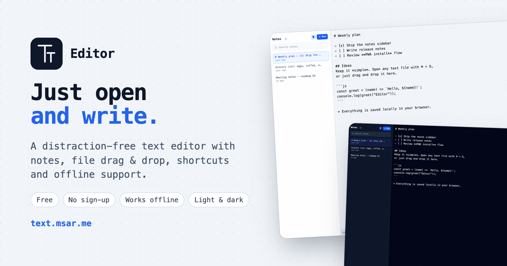
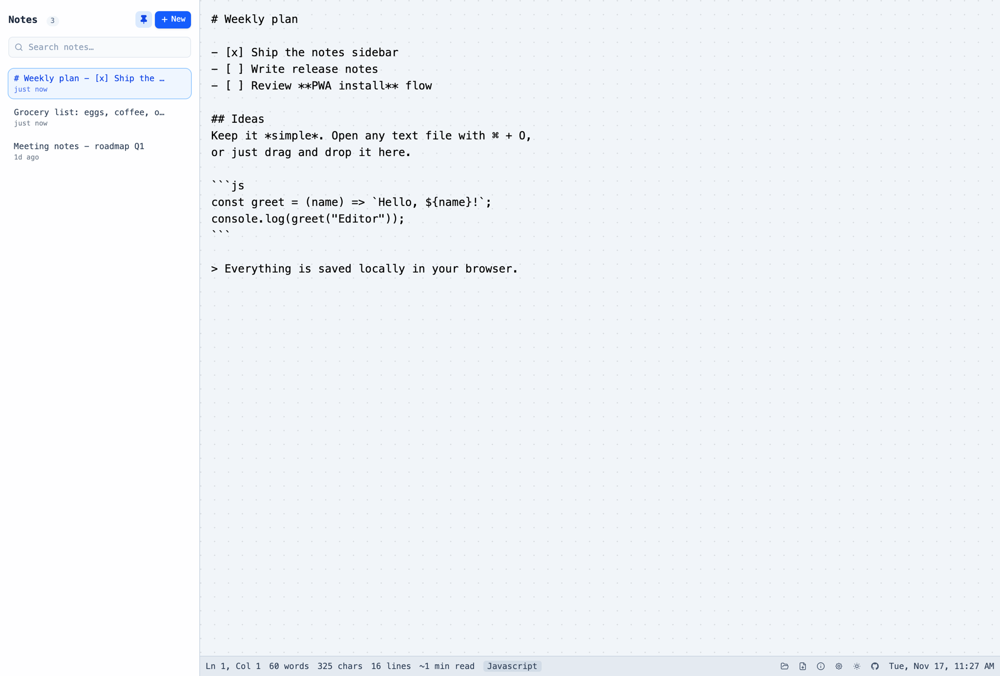
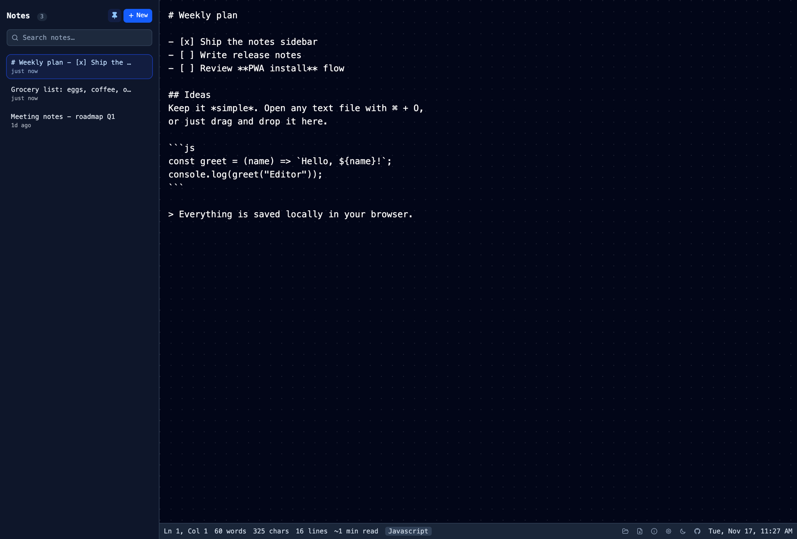

# Text Editor

A fast, distraction-free text editor that runs in your browser. Keep multiple notes, open or drag & drop text files, and keep writing offline – free, no sign-up, and everything stays on your device. Built with Vue 3, TypeScript and Tailwind CSS.



## ✨ Features

- **📝 Distraction-free writing** – a clean, full-screen monospace editor that opens instantly
- **🗂️ Multiple notes** – a searchable notes sidebar (pin it open or toggle it), keeping up to 50 recent notes
- **💾 Auto-save** – every note is saved in your browser's local storage; nothing leaves your device
- **📁 Open any text file** – browse with a shortcut or drag & drop a file onto the editor, and download a note back as a file
- **⌨️ Keyboard shortcuts** – formatting, case changes, indent/outdent and note management without touching the mouse
- **📊 Live status bar** – cursor position, words, characters, lines, reading time and the detected language of code blocks
- **🌓 Light, dark and system themes** – with a smooth reveal animation when you switch
- **⚙️ Customizable** – font size, layout (Auto, Box or Full width), logo visibility and new-note behavior
- **📱 Installable PWA** – install it like a desktop/mobile app and keep writing offline

## 🚀 Demo

**Live Demo**: [https://text.msar.me](https://text.msar.me)

| Light | Dark |
| --- | --- |
|  |  |

## 🔧 Installation

1. Clone the repository:
```bash
git clone https://github.com/4msar/text-editor.git
cd text-editor
```

2. Install dependencies:
```bash
npm install
# or
yarn install
```

3. Start the development server:
```bash
npm run dev
# or
yarn dev
```

4. Open your browser and visit `http://localhost:5173`

## 📖 Usage

### Notes
- Start typing – your note is saved automatically
- Press `Alt+N` (`⌥N` on Mac) to start a new note and `Alt+L` (`⌥L`) to show or hide the notes list
- Search notes from the sidebar, or pin the sidebar to keep it open

### Files
- **Open a file**: `Ctrl+O` / `⌘O`, or drag & drop a file onto the editor (up to 4 MB)
- **Download a note**: `Ctrl+S` / `⌘S`
- **Supported formats**: plain text, Markdown, JSON, YAML, source code and many more (see below)

### Keyboard Shortcuts

| Action | Windows / Linux | macOS |
| --- | --- | --- |
| Open file | `Ctrl+O` | `⌘O` |
| Download note | `Ctrl+S` | `⌘S` |
| Settings | `Ctrl+,` | `⌘,` |
| Help (all shortcuts) | `Ctrl+/` | `⌘/` |
| Close dialog / panel | `Esc` | `Esc` |
| New note | `Alt+N` | `⌥N` |
| Toggle notes list | `Alt+L` | `⌥L` |
| Bold / Italic / Underline | `Ctrl+B` / `Ctrl+I` / `Ctrl+U` | `⌘B` / `⌘I` / `⌘U` |
| Insert link | `Ctrl+K` | `⌘K` |
| Lowercase / Uppercase selection | `Ctrl+Shift+L` / `Ctrl+Shift+U` | `⌘⇧L` / `⌘⇧U` |
| Indent / Outdent | `Tab` / `Shift+Tab` | `Tab` / `⇧Tab` |

### Settings
Press `Ctrl+,` (`⌘,` on Mac) to open settings:
- **Theme** – Light, Dark or System
- **Layout** – Auto, Box or Full width
- **Show logo** – show or hide the logo in Box layout
- **New note behavior** – reopen the last note or start fresh
- **Font size** – make the editor text larger or smaller

## 🎯 Supported File Types

The editor supports a wide range of file formats including:

**Text & Documentation**: `.txt`, `.md`, `.csv`, `.log`, `.tex`  
**Web Technologies**: `.html`, `.css`, `.scss`, `.sass`, `.less`, `.js`, `.ts`, `.jsx`, `.tsx`, `.vue`  
**Programming Languages**: `.py`, `.java`, `.cpp`, `.c`, `.h`, `.php`, `.rb`, `.go`, `.rs`, `.swift`, `.kt`, `.dart`, `.lua`, `.sh`, `.sql`  
**Data & Config**: `.json`, `.xml`, `.yaml`, `.yml`, `.ini`, `.cfg`, `.conf`, `.env`, `.toml`  
**And many more...**

## 🛠️ Development

### Build for Production
```bash
npm run build
# or
yarn build
```

### Preview Production Build
```bash
npm run preview
# or
yarn preview
```

### Tech Stack
- **Framework**: Vue 3 with Composition API
- **Language**: TypeScript
- **Styling**: Tailwind CSS v4
- **Build Tool**: Vite
- **State Management**: VueUse (for localStorage and utilities)
- **Animation**: motion-v
- **PWA**: vite-plugin-pwa

## 🤝 Contributing

Contributions are welcome! Please feel free to submit a Pull Request.

## 📄 License

This project is open source. Please check with the repository owner for license details.

## 👨‍💻 Author

**Saiful Alam Rakib** - [@4msar](https://github.com/4msar)

---

**🌟 Star this repository if you find it helpful!**
